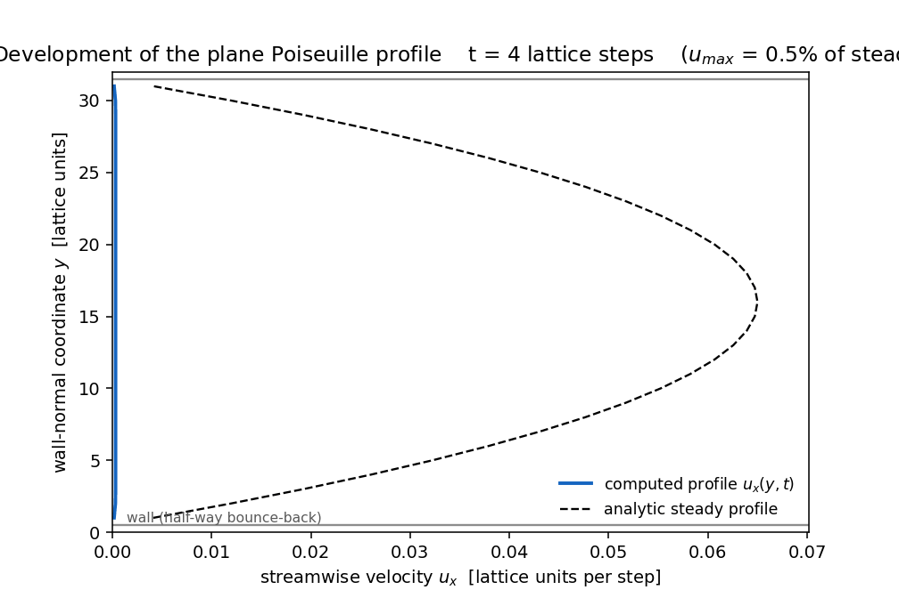

# Channel Lattice

**D2Q9 channel flow from lattice to continuum** — an original, NumPy-only
lattice-Boltzmann (BGK) solver for plane Poiseuille flow, verified against
the analytic parabolic profile.



*Animation: the computed velocity profile (blue) developing from the
zero-momentum start toward the analytic steady parabola (dashed),
`nx=64, ny=33, tau=0.9`, Re = 15.1, Ma = 0.11. Every frame is an actual
solver state captured between lattice steps 0 and 16 250 (startup
convention: `u(t=0) = g/2`, the Guo half-step value — visually flat);
generated by `python examples/run_verification.py` (Matplotlib
`PillowWriter`, 60 frames, 1008x672).*

## Purpose and scope

Channel Lattice demonstrates the full lattice-to-continuum chain for the
classical verification problem of CFD: a body-force-driven channel. The
discrete kinetic equation (D2Q9 streaming, BGK collision, Guo forcing,
half-way bounce-back walls) is evolved from the zero-momentum initial
state (Guo startup: `u(t=0) = g/2`), and the emergent
macroscopic profile is compared against the exact parabola — with the
walls at their true positions, the amplitude (not just the shape), the
conservation laws, and the convergence order all checked explicitly.

In scope: steady laminar, low-Mach, low-Re channel flow, its grid/tau
convergence behaviour, and exact discrete conservation diagnostics.
Out of scope: turbulence, curved boundaries, compressible flow, MRT/TRT
collision operators (see [Limitations](#limitations)).

## Model summary

* **Lattice** — D2Q9 on a uniform grid, `dx = dt = 1`, `cs^2 = 1/3`;
  weights `4/9`, `1/9` (axis), `1/36` (diagonal).
* **Collision** — BGK with relaxation time `tau`, lattice viscosity
  `nu = cs^2 (tau - 1/2) dt = (tau - 1/2)/3`.
* **Forcing** — Guo et al. (2002) scheme for `F = rho g e_x`:
  `f_q(x+c_q dt, t+dt) = f_q - (dt/tau)(f_q - f_q^eq) +
  (1 - dt/(2 tau)) S_q` with
  `S_q = w_q rho g [3(c_qx - u_x) + 9 (c_q.u) c_qx]` and the half-force
  velocity `u = (sum_q c_q f_q + F/2)/rho`.
* **Boundaries** — periodic streamwise (exact: the force stands in for the
  pressure gradient); no-slip walls by **half-way bounce-back**, which
  places the physical walls at `y = 0.5` and `y = ny - 1.5` so the
  effective channel height is `h = ny - 2` — verified empirically by
  fitting the parabola roots.
* **Reference solution** — `u(y) = (g/2nu)(y - 0.5)(ny - 1.5 - y)`,
  `u_max = g h^2/(8 nu)`.

Full equations, conventions, and the lattice/physical unit mapping:
[docs/model.md](docs/model.md).

## Quick start

```
python -m pip install -r requirements-dev.txt
python -m pytest tests -q
python examples/run_verification.py
```

The verification script writes `docs/results/` (profile plot, animated
GIF, convergence and tau-study CSVs/plots, `run_summary.json`) in about
6 minutes; the test suite runs in under 10 seconds.

## Architecture and API

```
channel_lattice/
    lattice.py     D2Q9 stencil: velocities, weights, equilibrium, Guo source
    solver.py      ChannelFlowLBM: collide -> stream -> bounce-back, diagnostics
    analytic.py    exact profile, force inversion, error norms, wall-root fit
    units.py       nu = cs^2(tau-1/2)dt and lattice <-> physical conversions
tests/             pytest suite (lattice, units, solver, end-to-end)
examples/          run_verification.py (results), readme_api_demo.py (below)
docs/              model.md, api.md, verification.md, results/
```

The runnable version of this snippet is committed as
`examples/readme_api_demo.py`:

```python
from channel_lattice import ChannelFlowLBM
from channel_lattice.analytic import force_for_target_u_max
from channel_lattice.units import lattice_viscosity

tau = 0.9
nu = lattice_viscosity(tau)                    # (tau - 1/2) / 3
g = force_for_target_u_max(0.06, nu, h_lattice=31)  # drive for u_max = 0.06

flow = ChannelFlowLBM(nx=64, ny=33, tau=tau, force_g=g)
flow.run_until_steady()                        # adaptive residual criterion

l2, linf = flow.error_norms()
print(f"steps={flow.steps}  rel_L2={l2:.3e}  rel_Linf={linf:.3e}")
print(f"walls at {flow.wall_positions}, h={flow.h_lattice}, "
      f"Re={flow.reynolds:.1f}, Ma={flow.mach:.3f}")
```

Reference: [docs/api.md](docs/api.md).

## Key metrics (measured)

| Benchmark (`nx=64, ny=33, tau=0.9`, Re 15.1, Ma 0.113) | Value |
|---|---|
| relative L2 profile error vs analytic | `2.09e-4` |
| relative Linf profile error | `1.53e-4` |
| `u_max` measured / analytic | `0.064990` / `0.065` |
| steady residual (per 250 steps) | `5.9e-12` |
| relative mass drift after 16 250 steps | `9.0e-13` |
| steady wall-drag / force imbalance | `8e-11` |
| parabola-root wall fit (`ny=25` test) | `0.5016` / `23.4984` vs `0.5` / `23.5` |

| Grid study (`tau=0.9`) | h=15 | h=23 | h=31 | h=47 | h=63 |
|---|---|---|---|---|---|
| rel. L2 | 8.93e-4 | 3.80e-4 | 2.09e-4 | 9.09e-5 | 5.06e-5 |

Measured convergence order **p = 2.00** (error ~ `dx^2`), consistent with
half-way bounce-back on lattice-aligned walls. The tau study shows the
error optimum near `tau ~ 0.9-1.0` and growth toward both `tau -> 1/2`
(viscosity collapse, bounce-back slip) and large `tau`. Full data:
[docs/verification.md](docs/verification.md),
[docs/results/run_summary.json](docs/results/run_summary.json).

## Verification summary

* Steady profile matches the analytic parabola with walls at their true
  positions `y = 0.5` and `y = ny - 1.5` — both shape and amplitude.
* Mass conserved to round-off (`~1e-13`); per-step momentum balance
  `dP = force + wall exchange` exact to round-off; in steady state the
  wall drag cancels the driving force.
* Second-order grid convergence measured across `h = 15..63`.
* Wall-placement convention proven empirically by parabola-root fit
  (half-way, not on-node or node-centre).
* `nu = cs^2 (tau - 1/2) dt` and the lattice/physical unit round trips
  are unit-tested.
* 55 pytest tests, all passing, < 60 s total.

## Limitations

* Low-Re laminar channel flow only (verified Re <= 15, Ma <= 0.11); no
  turbulence, transition, or three-dimensional effects.
* BGK collision: accuracy degrades as `tau -> 1/2` (measured L2 `1.4e-3`
  at `tau = 0.55` vs `4.8e-4` at `tau = 1.0`); the verified window is
  `tau in [0.55, 1.5]`. MRT/TRT would relax this at the cost of
  complexity.
* Straight walls aligned with the lattice; no curved-geometry boundary
  schemes.
* Weak-compressibility regime: density varies at O(Ma^2) and the
  incompressible parabola is the reference.

## References

* T. Krüger, H. Kusumaatmaja, A. Kuschnik, C. Silva, E. M. Viggen,
  *The Lattice Boltzmann Method: Principles and Practice*, Springer, 2017.
* Guo, Zheng & Shi, "Discrete lattice effects on the forcing term in the
  lattice Boltzmann method", *Physical Review E* 65, 046308 (2002),
  https://doi.org/10.1103/PhysRevE.65.046308.
* S. Succi, *The Lattice Boltzmann Equation for Fluid Dynamics and
  Beyond*, Oxford University Press, 2001.
* S. Chen & G. D. Doolen, "Lattice Boltzmann method for fluid flows",
  *Annual Review of Fluid Mechanics* 30, 329-364 (1998).

## License

MIT — see [LICENSE](LICENSE). Standard numerical methods, written from
scratch; every line of code in this repository is original work.
